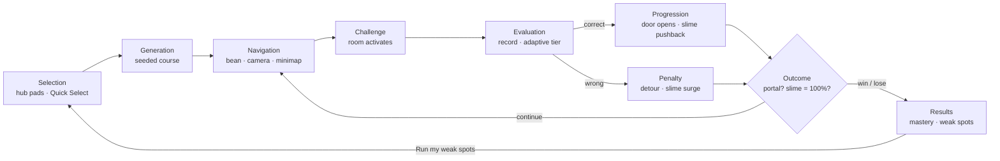

# Architecture

## Layers
| Layer | Tech | Owns | Rules |
|---|---|---|---|
| Engine | Plain TypeScript | All game state and simulation | No React or scene objects. Runs in Node, so Vitest drives real playthroughs. |
| Render | R3F | Meshes, materials, camera | Reads engine state in `useFrame`; never changes game state (the camera rig writes the camera). |
| UI | React DOM | HUD and menus | Reads the zustand store; sends commands through engine methods. |
| Store | zustand | UI snapshot | Written on events and at 10 Hz. |

## Data flow rules
1. Per-frame values (positions, timers, slime height) live in engine objects, not React state.
2. The engine writes the store on discrete events and at 10 Hz.
3. Scenes are keyed by `runId` and remount per run; label textures are disposed when a run ends.
4. No geometry, material or texture creation inside `useFrame`.
5. UI buttons call engine methods, which check whether the action is allowed.
6. Exception: `Minimap` and `DebugOverlay` read engine data directly on a 10 Hz timer.

## Brief step → module
| Brief step | Module |
|---|---|
| Domain/difficulty selection | `game/loop/selection.ts`, `ui/QuickSelect.tsx` |
| Maze generation | `game/loop/generation.ts`, `maze.ts` (incl. crossroads quiz mazes), `segments.ts` |
| Player navigation | `game/loop/navigation.ts`, `render/CameraRig.tsx`, `loop/visibility.ts` + `render/visibility.ts` (maze fade) |
| Challenge at checkpoint | `game/loop/challenge.ts`, `roomCommon.ts` (incl. answer timers), `game/rooms/*` |
| Answer evaluation | `game/loop/evaluation.ts` |
| Progression or penalty | `game/loop/progression.ts`, `rooms/detour.ts`, `rooms/junctionHall.ts`, `loop/powerups.ts` |
| Win/lose check | `game/loop/outcome.ts` |

## Server (`server/`, optional)
The game runs without it. It holds all LLM work for Any Topic: `api.ts` (routes as a pure function, tested without sockets), `index.ts` (node:http, CORS, serves `dist/`), `llm/pipeline.ts` (plan, write, validate, fix, review, top-up), `llm/safety.ts` (blocklist and topic gate), `cache.ts`, `jobs.ts`, `ratelimit.ts`. It imports only pure modules from `src/content/`; `src/` never imports from `server/`. The client side is `content/customClient.ts` (polls jobs), `content/customStore.ts` (recent packs in `lywo:packs:v1`) and `ui/TopicPanel.tsx`.

## Multiplayer (F3)
Ghost race: every laptop simulates only its own player on the same seeded course; the server relays 10 Hz states. Remote players never enter `G.run`.
- `src/net/protocol.ts`: message types and guards, shared with the server (pure). `server/mp/rooms.ts`: the room state machine (injected clock, no sockets). `server/mp/ws.ts`: the `ws` glue at `/ws`.
- `src/net/client.ts`: `NetClient` over a `Transport` (time sync, hello/resume, reconnect). `src/net/store.ts`: `createSession` plus the singleton `net` and the `useNet` store. The net layer depends on the engine (`startRun`, `netSnapshot`, the `runResult` event); the engine never imports it.
- Data-flow rule 6 gets a third exception: the renderer may read `remotes` (a plain `Map` of `{ buf: Snapshot[] }`), `emotes` and `localProgress` (plain objects, all in `src/net/store.ts`) in `useFrame`; `Minimap` and `RaceStrip` read them on a timer.
- Seeing each other (M3): `render/RemotePlayers.tsx` mounts `GhostPlayers` (with a `GhostLook`: 85% opacity, fade and a 📶 tag when stale or disconnected, hidden once finished, name tag, emote icon) over `net.source`. `GhostPlayers` re-applies `withVisibility` to its cloned materials, because `Material.clone()` drops `onBeforeCompile` and the clones would otherwise skip the maze fade (this fixes the daily ghost too). `ui/RaceStrip.tsx` polls `remotes` and `useNet` at 4 Hz; the minimap draws a dot per remote. `net/race.ts` holds the pure helpers (standings sort, awards, rank, emote cooldown, name-tag text).
- Race results (M4): the session tallies best combo and completed detours per player from the state feed (`useNet.stats`); `ui/RaceResults.tsx` is a tab on `ResultsCard` for online runs. `emotes` (plain map in `store.ts`) holds the newest emote per remote; my own goes in `useNet.myEmote` (the server does not echo it).
- Online mode (`RunSelection.mode === 'online'`): no pause (Esc opens `leaveMenuOpen`), no visibility auto-pause, no debug keys, `startRun(sel, { countdownAt })` holds the countdown until a wall-clock moment.

## Collision
Custom and deterministic: the player is a circle in XZ against axis-aligned wall boxes, resolved in two passes per 1/120 s step. Static walls and floors sit in a spatial hash; dynamic ones (doors, gates, tiles) are checked every step. Max speed per step is far below the radius, so nothing tunnels.

## Visibility (maze fade)
`loop/visibility.ts` gives the target radius for the player's segment (small in mazes on Normal/Hard, open elsewhere). `render/visibility.ts` patches materials with `onBeforeCompile`, using shared uniforms. `toon()` patches by default; pass `fade = false` to opt out (clouds). Fragments fade to the horizon colour between 0.6 R and R. `VisibilityDriver` in `Scene.tsx` eases R and moves the centre each frame, without allocating. Things that must stay crisp but still hide (junction signs) fade their opacity with `visOpacity()`.

## Balance harness
`src/tests/bot.ts` plays whole runs with the real controller: perfect play, p-accuracy players or pure guessers, including detours, crossroads and the Junction Hall. `src/tests/balance.test.ts` prints a table of P(elim), slime at the end and time per difficulty. For tuning, run `BALANCE_N=40 BALANCE_DIFF=hard npx vitest run src/tests/balance.test.ts --silent=false`. Numbers go in `tuning.ts`.

## Adding a room kind
1. Add the kind to `RoomKind` and a builder in `loop/segments.ts`; add it to `ROOM_KINDS`, the `Step` union (`loop/pool.ts`) and `stepDepth` / `placeStep` in `generation.ts`.
2. Create `rooms/<kind>.ts` with `activate`, `step`, and touch/fall handlers. Dispatch it in `loop/challenge.ts` (`activateRoom`, `stepChallenge`, `handleRoomTouch`). If it asks several questions, size its slots in `createRooms`.
3. Add its `TIPS`, `TITLES` and `footerFor` text in `roomCommon.ts`, and its minimap letter in `ui/Minimap.tsx`. If lifelines apply, extend `canFiftyRoom` and `applyFifty` in `progression.ts`.
4. Render its entities in `render/RoomEntities.tsx` (or its own component mounted in `DynamicEntities.tsx`). Wrap new materials with `withVisibility` if they live near mazes.
5. Teach the bot to solve it (`Player.solve` in `tests/bot.ts`), so the full-run and balance tests still reach QUALIFIED.
6. **Register it in the pool last**, once its bot test passes: add a `PoolEntry` to `POOL` in `loop/pool.ts` (`weight`, `big`, `classic`, `minDifficulty`, `fits(pack)` for the question supply). Add its icon and minimap letter to `ui/roomInfo.ts`, and its per-segment par time to `T.PAR_S` (measure with `CALIBRATE=1 npx vitest run src/tests/calibrate.test.ts --silent=false`). The pool tests check that every entry gets picked, and `fullrun.test.ts` plays it on 20 seeds per difficulty.

Boulder Run (`rooms/boulderRun.ts`, geometry in `loop/boulderBuild.ts`) shows the pattern for a room whose entities move on the run clock: the boulder's position is engine state (`room.boulder`) advanced by `step`, the renderer (`render/BoulderRun.tsx`) only reads it.

Shifting Maze (`rooms/shiftMaze.ts`, `loop/shiftPlan.ts`, `loop/shiftBuild.ts`) moves dynamic walls and the live `MazeInfo` arrays together; every plan passes `exitAlwaysReachable` before it is applied.

A maze variant (Key Hunt) is a room kind too: it is a `maze` segment (so the minimap, visibility and Compass see it in `course.mazes`) with a RoomLayout, built in its own file (`loop/huntBuild.ts`) and registered with `slot: 'maze'`.

## Recipes, the room pool and the Gauntlet (F4-0)
`loop/pool.ts` holds the recipes. Anchors (start, first maze, quizMaze, the fork and its lane rooms, slimeGate, exit) are fixed steps. `slot` and `mazeSlot` steps are filled by `resolveRecipe` from `POOL`, with the named random stream `recipe` (never the `layout` stream, so anchors keep their layout for a seed). Rules: no kind twice unless the pool is smaller than the slots, no two `big` rooms in consecutive slots, Normal and Hard get at least half their slots from non-classic rooms (as far as the pool allows), and `minDifficulty` / `fits(pack)` filter entries. `?demo=1` uses the pinned `DEMO_RECIPE`; `RunSelection.mode = 'gauntlet'` uses `gauntletRecipe` (every eligible room once). `CLASSIC_RECIPES` are the old fixed recipes; `tests/helpers.ts` `boot()` builds them by default (`recipeOverride`) so the room-by-room tests keep a stable course, while the full-run, balance and pool tests use the real pool.

Par time is no longer a table per difficulty: `parTimeMs(difficulty, segments, route)` sums `T.PAR_S[segment kind]` over the segments on the route and adds `T.PAR_READ_S` per room.

## Moving floors (F4-8)
Any dynamic `FloorRect` with `moving: true` can change its `top` every step. The room sets `top` from its own state and the fixed step (never wall time), and `rideFloors` in `loop/navigation.ts` (called first in `stepPlayer`) carries a grounded player who stood on it at the height the controller last applied (`prevTop`). Answer Lifts (`rooms/answerLifts.ts`, builder in `loop/bigRoomsBuild.ts`, view `render/AnswerLifts.tsx`) and the Hex Finale tiles use it. Floors must keep risers under `STEP_UP` minus a margin (gravity dips the bean a hair below the floor every step, so a 0.25 riser is not climbable). Walls with `maxY` at or below the floor level (the pond's dock edge) block a bean down in the pit and let one on a step or a lift pass.

## Hex Finale (F4-X)
`rooms/hexFinale.ts` (state machine ask -> fall -> rest -> restore, driven by the fixed step `h`), builder `buildHexFinale` in `loop/bigRoomsBuild.ts`, view `render/HexFinale.tsx`. The arena is `HEX_RINGS` rings of pointy-top hexes; each is a dynamic, moving floor rect of sqrt(3)*s by 1.5*s (these rects tile the plane with no gaps; the view draws hex prisms). Clusters are pie slices of the disc (rotated randomly each round from the question stream). The last room is chosen by `RunSelection.finale` (`'hex'` swaps the Slime Gate in `applyFinale`, `loop/pool.ts`): the solo Settings checkbox sets it in `engine.startRun`; online, `start.players >= HEX_MIN_PLAYERS` (`finaleFor` in `net/race.ts`) sets it, so the course is identical on every laptop. The daily course, the Gauntlet and `?demo=1` never use it.

## Hazards (F4-4)
`loop/hazardPlace.ts` places sweepers, hammers and ice patches (stream `hazards`) from the plain maze and corridor builders. `loop/hazards.ts` holds the run-time part: `moveHazards` (hammer heads), `stepHazards` (hazard clock, hit test) and `hitPlayer` (knockback, stun, slime, Shield). Everything is a function of `run.hazardMs`, so it is deterministic and frozen by Slime Freeze. Ice is a flag on `NavCtx` (`ctx.ice`) that scales ground acceleration in `stepPlayer`. `render/Hazards.tsx` draws them with the shared toon materials (so they fade with the maze visibility) and the Shield bubble.
